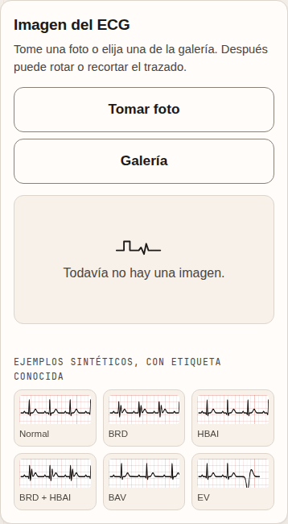
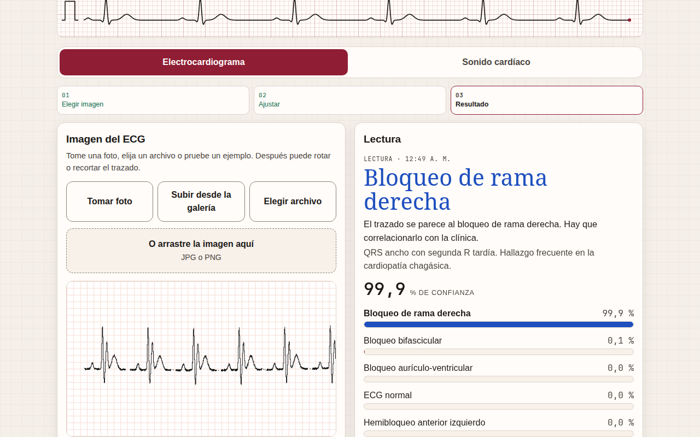
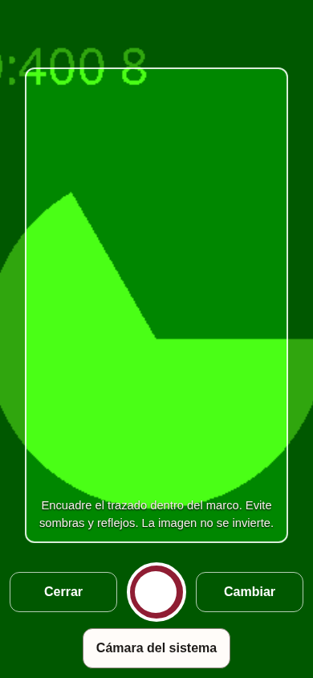
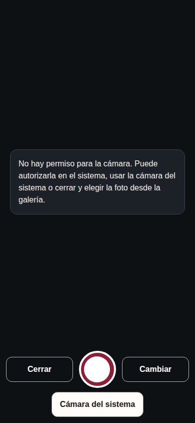
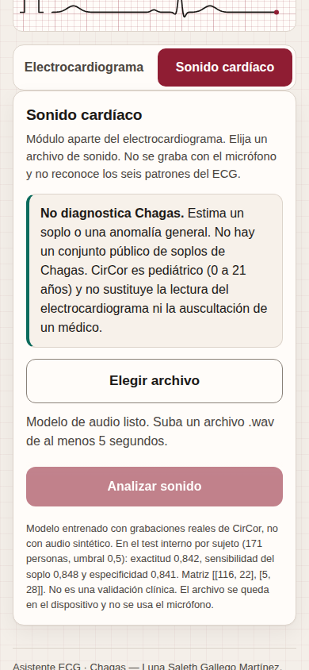
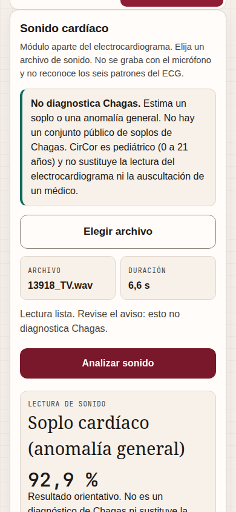

# Verificación de audio, cámara, galería y APK

Fecha: 23 de noviembre de 2026. Proyecto educativo. No es un dispositivo médico
y no diagnostica Chagas.

## Qué se probó

| Pieza | Dónde | Resultado |
|---|---|---|
| ECG, imagen de demostración `brd_000.png` | Navegador, escritorio | Bloqueo de rama derecha, 99,9 %. Seis barras. |
| Foto en vivo | Navegador, 390×844, cámara simulada | Vista previa, guía, cambio de cámara y captura de 640×480. |
| Permiso de cámara negado | Navegador | Mensaje claro. La página sigue y la galería queda disponible. |
| Galería | Navegador | Botón «Galería», `accept="image/*"`, sin `capture`. |
| Audio real CirCor `13918_TV.wav` | Navegador | 6,6 s. «Soplo cardíaco (anomalía general)», 92,9 %. |
| Audio de 3 s | Navegador | «Incierto». No se asigna clase: hacen falta 5 s. |
| Micrófono | Navegador | No se llama a `getUserMedia` de audio. No hay botón de grabar. |
| Librerías | Navegador | TensorFlow.js se carga desde `app/vendor/`, no desde una red externa. |
| APK debug | Gradle `assembleDebug` | 8,7 MB, firmado con el certificado Android Debug. Dentro van `tf.min.js`, Teachable Machine, `asistente.html` y `modelo/audio/`. |
| Permisos del APK | `aapt dump permissions` | `CAMERA` y el permiso interno de AndroidX. No hay `RECORD_AUDIO`, ni lectura de fotos, ni `INTERNET`. |

El wav `13918_TV.wav` es una grabación real de CirCor (PhysioNet, ODC-By 1.0),
foco TV, con soplo presente en el manifiesto. No se sube al repositorio.

## Métricas que se muestran en la app

Son las del test interno por sujeto, umbral 0,5, ya publicadas en
`modelo/audio/metricas.json`:

| | |
|---|---|
| Sujetos | 171 |
| Exactitud | 0,8421 |
| Sensibilidad del soplo | 0,8485 |
| Especificidad del soplo | 0,8406 |
| Matriz [[tn, fp], [fn, tp]] | [[116, 22], [5, 28]] |

No es una validación clínica. CirCor es pediátrico (0 a 21 años). El audio
estima un soplo o una anomalía general y no diagnostica Chagas.

## Qué no se probó

- Un teléfono físico.
- El emulador. La imagen de Android 36 está descargada, pero este usuario no
  puede usar `/dev/kvm` (`x86_64 emulation currently requires hardware
  acceleration`). El APK sí se compiló y `aapt dump permissions` confirmó los
  permisos. Instalarlo en un emulador o un teléfono queda en `mobile/README.md`.
- No se volvió a entrenar ni a medir el modelo de audio: se usaron las cifras
  ya escritas en `modelo/audio/metricas.json`.

## Capturas

Dos botones del electrocardiograma, en 390 px de ancho:

Lectura de una imagen de ECG en escritorio:

Cámara en vivo (video simulado del navegador):

Sin permiso de cámara:

Sonido cardíaco, solo con «Elegir archivo»:

Resultado del wav real de CirCor:

